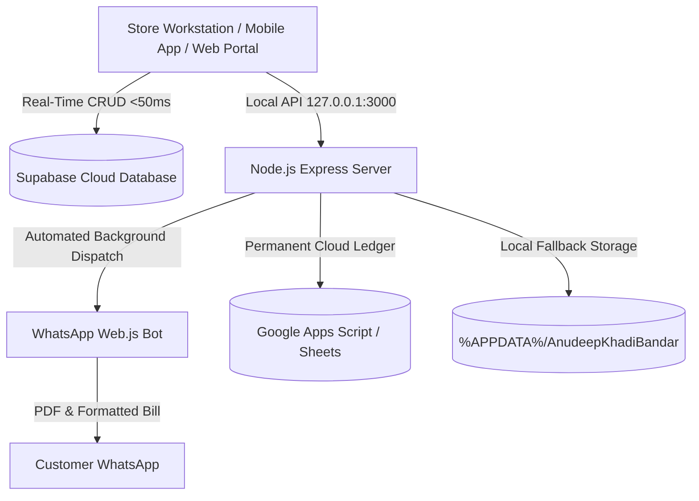

# Anudeep Khadi Bandar - GST Billing & Invoicing System

A turnkey, enterprise-grade GST billing and inventory system with real-time Supabase cloud synchronization, automated WhatsApp PDF dispatch, Google Sheets ledger backup, and dedicated workstation POS desktop software.

---

## 🏛️ System Architecture



### 1. Dual-Redundant Database Layer
- **Primary Live Database**: Supabase Cloud PostgreSQL with WebSocket Realtime subscriptions. Every invoice created or modified syncs across all devices in under 50ms.
- **Secondary Cloud Archive**: Google Apps Script (`backend.gs`) streaming all transactions into Google Sheets.
- **Local Workstation Fallback**: `%APPDATA%\AnudeepKhadiBandar\data\` (`invoices.json`, `products.json`, `receivers.json`, `consignees.json`, `settings.json`) guaranteeing 100% offline billing continuity.

### 2. Multi-Mode WhatsApp Dispatch Engine
- **Shop Workstation Bot Mode**: Automated background WhatsApp bot (`whatsapp-web.js`) hosted on the store computer. As soon as an invoice is created on any connected device, the shop PC automatically delivers the formatted receipt and attaches the high-definition PDF bill.
- **Remote Mobile / Web Mode**: When accessed from smartphones, tablets, or external browsers, invoices are delivered with 1 tap via the **Native Web Share API** (`navigator.share`) or direct WhatsApp deep linking (`https://api.whatsapp.com/send`), allowing the cashier or salesman to send the PDF invoice directly into the customer's chat without needing a local server.
- **Cloud Pairing Code Relay**: Remote devices can request a WhatsApp pairing code via Supabase cloud without triggering localhost network errors.

### 3. Master Admin Security Policy
- **Primary Master Admin**: `kandukurijagan99@gmail.com`
- **Immutable Lock**: Permanently locked at index 0 across Frontend, Backend, and Database tiers.
- **Undeletable**: Frontend hides delete buttons for the primary admin; backend strictly rejects any attempt to exclude or delete `kandukurijagan99@gmail.com`.
- **Secondary Admins**: Additional emails can be authorized or removed dynamically for OTP password reset requests.

---

## 🖥️ Desktop Workstation POS Application

The workstation app runs in a dedicated, high-speed POS container with full keyboard shortcuts, silent printing, and automatic background server management.

### Launching the Application
- **Desktop Shortcut**: Double-click **`Anudeep Khadi Bandar - GST Billing`** on your Windows Desktop.
- **Batch Launcher**: Double-click [`Launch-AKB-App.bat`](file:///c:/Users/ADMIN/Desktop/anudeep-kadir-bandi/Launch-AKB-App.bat).
- **Executable Launcher**: Run [`AKB-Billing.exe`](file:///c:/Users/ADMIN/Desktop/anudeep-kadir-bandi/AKB-Billing.exe).
- **NPM Command**:
  ```bash
  npm run app
  ```

### Workstation Hotkeys & Shortcuts
| Hotkey | Action | Description |
| :--- | :--- | :--- |
| <kbd>F2</kbd> | **New Invoice** | Opens billing view and focuses customer name field |
| <kbd>F4</kbd> | **Focus Products** | Jumps focus directly to product selector / barcode input |
| <kbd>Ctrl</kbd> + <kbd>S</kbd> / <kbd>F8</kbd> | **Save & Generate** | Finalizes invoice, records to cloud, and triggers WhatsApp |
| <kbd>Ctrl</kbd> + <kbd>P</kbd> | **Print Invoice** | Direct silent print spooling to default POS printer |
| <kbd>Ctrl</kbd> + <kbd>H</kbd> | **Invoice History** | Opens invoice ledger with live search & filters |
| <kbd>Esc</kbd> | **Dismiss** | Closes active modal, dropdown, or search overlay |

---

## 📱 Mobile App & Remote Access (PWA)

The billing system is fully installable as a Progressive Web App (PWA) on Android, iPhone, iPad, and tablet devices.

- **Web Portal URL**: [`https://kandukurijagan1.github.io/anudeep/`](https://kandukurijagan1.github.io/anudeep/)
- **Android Installation**: Open the link in Google Chrome &rarr; tap the top menu (<kbd>⋮</kbd>) &rarr; tap **"Install app"** or **"Add to Home screen"**.
- **iPhone / iPad Installation**: Open the link in Safari &rarr; tap the Share button (<kbd>📤</kbd>) &rarr; tap **"Add to Home Screen"**.
- **Features on Mobile**:
  - Full offline support with Service Worker caching (`sw.js`).
  - 1-Tap PDF sharing to WhatsApp.
  - Real-time cloud sync with the store's master computer.

---

## 🧪 Testing & Automated Diagnostics

The repository includes a comprehensive 24-point diagnostic test suite:

```bash
npm test
```

### Test Coverage
- **API & Connectivity**: Health check, Sync Heartbeat, Bootstrap round-trip loader.
- **Data Integrity**: Local JSON storage, invoice consistency, product pricing validation.
- **GST Calculations**: Strict validation of CGST (2.5%), SGST (2.5%), IGST (5.0%), taxable totals, and invoice rounding.
- **WhatsApp Engine**: Bot readiness, pairing code support, session persistence.
- **Security & RBAC**: Master admin email lock verification, OTP validation endpoints.

To run tests and open the visual HTML report:
```bash
npm run test:report
```

---

## 📂 Project Structure & Organization

```
anudeep-kadir-bandi/
├── index.html                   # Core Single-Page Application (POS, Billing, UI)
├── server.js                    # Node.js Express Backend & WhatsApp Automation Engine
├── sw.js                        # Production Service Worker for Mobile PWA
├── manifest.json                # PWA Web Application Manifest
├── version.json                 # OTA Cloud Version Tracker
├── backend.gs                   # Google Apps Script cloud database integration
├── electron-main.js             # Electron desktop workstation shell
├── Launcher.cs                  # C# Native Windows POS launcher source
├── AKB-Billing.exe              # Compiled native Windows launcher binary
├── Launch-AKB-App.bat           # Resilient multi-tier launch pipeline script
├── create-desktop-shortcut.ps1  # Automated Windows desktop shortcut installer
├── test-agent.js                # 24-Point automated test & diagnostics agent
├── test-report.html             # Visual HTML diagnostic test report
├── test-report.json             # Structured JSON diagnostic test results
├── icon.ico / icon-*.png        # Application icons & branding assets
└── data/                        # Master ledger files (Invoices, Products, Settings)
    ├── invoices.json
    ├── products.json
    ├── receivers.json
    ├── consignees.json
    └── settings.json
```

---

## 🔒 Administration & Support
- **Store**: Anudeep Khadi Bandar, Main Road, Tenali, A.P.
- **Master Admin**: `kandukurijagan99@gmail.com`
- **Workstation Port**: `3000` (Default HTTP endpoint: `http://127.0.0.1:3000`)
